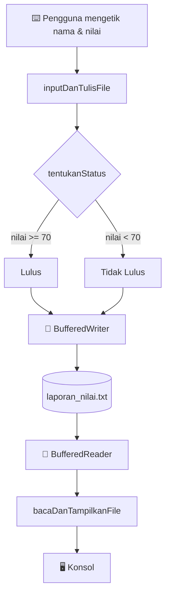

# 📝 Pert6: Laporan Nilai Siswa (Java File I/O)

Program konsol Java yang menerima data nilai siswa dari keyboard, menyimpannya sebagai laporan ke `laporan_nilai.txt`, lalu membaca ulang file itu untuk ditampilkan sebagai bukti bahwa data benar-benar tersimpan.

---

## 1. Identitas Mahasiswa

| Keterangan | Isi |
|---|---|
| **Nama** | Febrian Zaki Hidayatulloh |
| **NIM** | L0325045 |
| **Program Studi** | Informatika PSDKU Kebumen |
| **Kelas** | B |
| **Universitas** | Universitas Sebelas Maret |
| **Tugas** | Pert6: Pengelolaan Data Nilai Siswa (File I/O) |
| **Bahasa** | Java |

---

## 2. Latar Belakang & Deskripsi Sistem

### 2.1 Latar Belakang

Variabel di dalam program hanya hidup selama program berjalan. Begitu program ditutup, semua data ikut lenyap. Agar data bertahan (*persistent*), program perlu menulisnya ke media penyimpanan, salah satunya **file teks**.

Tugas ini mensimulasikan kerja seorang guru yang menginput nilai satu kelas. Program menghitung status dan ringkasan secara otomatis, menyimpannya sebagai laporan, lalu membaca kembali file tersebut sebagai langkah verifikasi.

### 2.2 Cara Kerja Singkat

```
⌨️  Keyboard  →  🧮 Hitung status & ringkasan  →  💾 Tulis ke file  →  📖 Baca file  →  🖥️ Tampilkan di konsol
```

Program dibuat secara **prosedural**: logika dipecah menjadi method `static` yang masing-masing punya satu tugas jelas, lalu dirangkai di `main`.

---

## 3. Tujuan Pembelajaran & Ruang Lingkup

### 3.1 Konsep yang Dipraktikkan

| Konsep | Implementasi dalam program |
|---|---|
| Input konsol | `Scanner` dengan `nextLine()` |
| Menulis file | `FileWriter` dibungkus `BufferedWriter` |
| Membaca file | `FileReader` dibungkus `BufferedReader`, `readLine()` sampai `null` |
| Resource management | `try-with-resources` (Scanner, writer, dan reader tertutup otomatis) |
| Exception handling | `catch` untuk `IOException` dan `NumberFormatException` |
| Modularisasi | Method `static` terpisah dan konstanta `static final` |

### 3.2 Ruang Lingkup Fungsional

- Menerima jumlah siswa, lalu nama (`String`) dan nilai (`double`) tiap siswa.
- Menentukan status **Lulus / Tidak Lulus** berdasarkan batas nilai.
- Menulis laporan lengkap beserta ringkasan ke file.
- Membaca file dan mencetaknya ke konsol baris demi baris.

---

## 4. Struktur Proyek & Aliran Data

### 4.1 Struktur Folder

```
📦 Pert6-LaporanNilai
 ┣ 📂 Pert6
 ┃ ┗ 📜 LaporanNilai.java     ← seluruh logika program
 ┣ 📄 laporan_nilai.txt        ← dibuat otomatis saat program dijalankan
 ┗ 📘 README.md
```

### 4.2 Aliran Data



---

## 5. Peta Method

| Elemen | Peran |
|---|---|
| `NAMA_FILE` | Konstanta nama file output (`"laporan_nilai.txt"`) |
| `BATAS_LULUS` | Konstanta nilai minimum kelulusan (`70.0`) |
| `tentukanStatus(double nilai)` | Mengembalikan `"Lulus"` atau `"Tidak Lulus"` |
| `inputDanTulisFile(Scanner sc)` | Langkah 1: baca input, hitung ringkasan, tulis ke file |
| `bacaDanTampilkanFile()` | Langkah 2: baca file dan tampilkan ke konsol |
| `main(String[] args)` | Langkah 3: merangkai semua dan menangani exception |

---

## 6. Bedah Kode Sumber

### 6.1 Konstanta: Satu Tempat untuk Satu Aturan

```java
static final String NAMA_FILE = "laporan_nilai.txt";
static final double BATAS_LULUS = 70.0;
```

Nama file dan batas lulus dipisahkan sebagai konstanta. Kalau aturan kelulusan berubah menjadi 75, cukup ubah satu baris, bukan mencari angka 70 di seluruh kode.

### 6.2 Penentuan Status dengan Operator Ternary

```java
static String tentukanStatus(double nilai) {
    return nilai >= BATAS_LULUS ? "Lulus" : "Tidak Lulus";
}
```

Operator `>=` membuat nilai tepat **70.0** dinyatakan *Lulus*. Method ini hanya mengembalikan teks, tanpa input atau output, sehingga mudah diuji sendiri.

### 6.3 Membaca Input dengan `nextLine()`

```java
int jumlah = Integer.parseInt(sc.nextLine().trim());
String nama = sc.nextLine().trim();
double nilai = Double.parseDouble(sc.nextLine().trim());
```

Semua input dibaca sebagai satu baris penuh lalu dikonversi sendiri. Keuntungannya:

- Nama berspasi seperti `"Raihan Hanan"` terbaca utuh.
- Tidak ada masalah *newline tertinggal* yang biasa muncul bila `nextInt()` atau `nextDouble()` dicampur dengan `nextLine()`.
- `trim()` membuang spasi berlebih di awal dan akhir.

### 6.4 Menulis File dengan try-with-resources

```java
try (BufferedWriter writer = new BufferedWriter(new FileWriter(NAMA_FILE))) {
    writer.write("=== LAPORAN NILAI SISWA ===");
    writer.newLine();
    ...
}
```

`FileWriter` membuka koneksi ke file, sedangkan `BufferedWriter` menampung teks di memori dulu sebelum ditulis ke disk sehingga lebih efisien. Blok `try (...)` memastikan `writer.close()` dipanggil otomatis, bahkan ketika terjadi error di tengah jalan. `newLine()` dipakai agar pemisah baris sesuai sistem operasi.

### 6.5 Menghitung Ringkasan Sambil Menulis

```java
totalNilai += nilai;
if (status.equals("Lulus")) jumlahLulus++; else jumlahTidakLulus++;
...
double rataRata = (jumlah > 0) ? totalNilai / jumlah : 0;
writer.write(String.format("Rata-rata nilai kelas : %.2f", rataRata));
```

Total, jumlah lulus, dan jumlah tidak lulus dikumpulkan di dalam loop yang sama dengan penulisan data, jadi data tidak perlu disimpan dalam array. Ternary `(jumlah > 0) ? ... : 0` mencegah pembagian dengan nol.

### 6.6 Membaca File Baris demi Baris

```java
String baris;
while ((baris = reader.readLine()) != null) {
    System.out.println(baris);
}
```

`readLine()` mengembalikan satu baris tiap dipanggil dan mengembalikan `null` saat file habis (EOF), yang menghentikan loop secara alami.

### 6.7 `main`: Satu Pintu untuk Semua Error

```java
try (Scanner sc = new Scanner(System.in)) {
    inputDanTulisFile(sc);
    bacaDanTampilkanFile();
} catch (IOException e) {
    ...
} catch (NumberFormatException e) {
    ...
}
```

Method `inputDanTulisFile` dan `bacaDanTampilkanFile` memakai `throws IOException`, sehingga penanganan error cukup di satu tempat. `Scanner` juga ikut ditutup otomatis.

---

## 7. Alur Program & Mekanisme Validasi

### 7.1 Tabel Penanganan Error

| Kondisi | Exception | Pesan yang tampil | Dampak |
|---|---|---|---|
| Jumlah siswa atau nilai bukan angka (misal `abc`) | `NumberFormatException` | `Input tidak valid, harus berupa angka: ...` | Program berhenti; file terisi sebagian (lihat 10) |
| File tidak bisa ditulis atau dibaca (izin ditolak, dsb.) | `IOException` | `Terjadi kesalahan I/O: ...` | Program berhenti |
| Jumlah siswa `0` | (tidak ada) | Tidak ada error | Rata-rata ditulis `0,00` berkat pengecekan `jumlah > 0` |

### 7.2 Tabel Keputusan Status

| Nilai | Hasil | Alasan |
|---|---|---|
| `>= 70.0` | ✅ Lulus | Memenuhi `BATAS_LULUS` |
| `< 70.0` | ❌ Tidak Lulus | Di bawah batas |

---

## 8. Panduan Kompilasi & Eksekusi

**Prasyarat:** JDK (Java Development Kit) 8 atau lebih baru.

### 8.1 Lewat Terminal

Dari folder yang berisi `LaporanNilai.java`:

```bash
javac -d out LaporanNilai.java
java -cp out Pert6.LaporanNilai
```

File `laporan_nilai.txt` akan dibuat di folder tempat perintah `java` dijalankan.

### 8.2 Lewat NetBeans

1. Buat project **Java with Ant > Java Application** (hilangkan centang *Create Main Class*).
2. Buat class `LaporanNilai` di **Source Packages** (package `Pert6`), lalu tempel kodenya.
3. Klik kanan file > **Run File** (`Shift + F6`).
4. Ketik input di panel **Output**.
5. File `laporan_nilai.txt` muncul di folder project, sejajar dengan folder `src`.

---

## 9. Hasil Pengujian & Analisis

### 9.1 Data Uji Utama (5 siswa)

| No | Nama | Nilai | Status |
|---|---|---|---|
| 1 | Jeki | 85.0 | ✅ Lulus |
| 2 | Ridwan | 90.0 | ✅ Lulus |
| 3 | Nisa | 65.0 | ❌ Tidak Lulus |
| 4 | Faza | 80.0 | ✅ Lulus |
| 5 | Bule | 50.0 | ❌ Tidak Lulus |

### 9.2 Isi `laporan_nilai.txt`

```
=== LAPORAN NILAI SISWA ===

1. Nama   : Jeki
   Nilai  : 85.0
   Status : Lulus

2. Nama   : Ridwan
   Nilai  : 90.0
   Status : Lulus

3. Nama   : Nisa
   Nilai  : 65.0
   Status : Tidak Lulus

4. Nama   : Faza
   Nilai  : 80.0
   Status : Lulus

5. Nama   : Bule
   Nilai  : 50.0
   Status : Tidak Lulus

---------------------------
RINGKASAN
Rata-rata nilai kelas : 74,00
Jumlah siswa lulus    : 3
Jumlah tidak lulus    : 2
```

### 9.3 Verifikasi Perhitungan

- Total nilai: 85 + 90 + 65 + 80 + 50 = **370**
- Rata-rata: 370 / 5 = **74,00** ✔
- Lulus (>= 70): Jeki, Ridwan, Faza = **3 siswa** ✔
- Tidak lulus (< 70): Nisa, Bule = **2 siswa** ✔

### 9.4 Skenario Uji Tambahan

Hasil di bawah ini adalah perilaku yang diharapkan berdasarkan alur kode.

| Skenario | Input | Hasil yang diharapkan |
|---|---|---|
| Tepat di batas | Nilai `70` | Status **Lulus** (operator `>=`) |
| Sedikit di bawah batas | Nilai `69.99` | Status **Tidak Lulus** |
| Kelas kosong | Jumlah siswa `0` | Loop tidak jalan, rata-rata `0,00`, lulus `0`, tidak lulus `0` |
| Nama berspasi | `Raihan Hanan` | Tersimpan utuh karena memakai `nextLine()` |
| Input bukan angka | Nilai `abc` | Pesan *Input tidak valid, harus berupa angka* |

### 9.5 Catatan Format Desimal

Rata-rata tampil sebagai `74,00` (koma) karena `String.format` mengikuti **locale sistem** (Indonesia memakai koma). Sementara nilai `double` yang ditulis langsung lewat penggabungan string tetap memakai titik (`85.0`). Jadi satu file bisa memuat dua gaya desimal. Ini bukan bug, melainkan perilaku bawaan Java.

---

## 10. Batasan & Ide Pengembangan

### 10.1 Batasan Saat Ini

- **Data tertimpa:** `FileWriter` tanpa parameter `true` membuka file dalam mode *overwrite*, sehingga laporan lama hilang setiap program dijalankan.
- **File parsial saat salah input:** jika pengguna salah mengetik angka di tengah proses, program berhenti dengan pesan error. File sudah terlanjur berisi data siswa sebelumnya tanpa bagian ringkasan, dan tahap pembacaan file tidak dijalankan.
- **Tidak ada validasi rentang:** nilai seperti `-10` atau `150` tetap diterima.
- **Tidak ada fitur edit atau hapus:** alur program satu arah (input, simpan, tampil).

### 10.2 Ide Pengembangan

- [ ] Validasi nilai harus di antara 0 dan 100, dengan input diulang jika salah, bukan langsung berhenti.
- [ ] Gunakan `String.format(Locale.US, ...)` agar format desimal konsisten di semua komputer.
- [ ] Mode *append* (`new FileWriter(NAMA_FILE, true)`) untuk menyimpan histori laporan.
- [ ] Tampilkan nilai tertinggi, nilai terendah, dan nama siswa terbaik di ringkasan.
- [ ] Simpan data siswa dalam `ArrayList` agar bisa diurutkan atau dicari.
- [ ] Ekspor laporan ke format CSV.

---

<p align="center">Dibuat oleh <b>Febrian Zaki Hidayatulloh</b> (L0325045) · Informatika PSDKU Kebumen · UNS</p>
