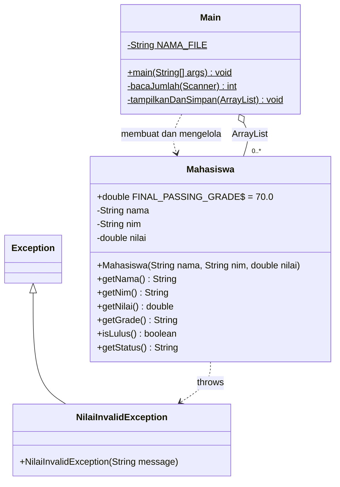
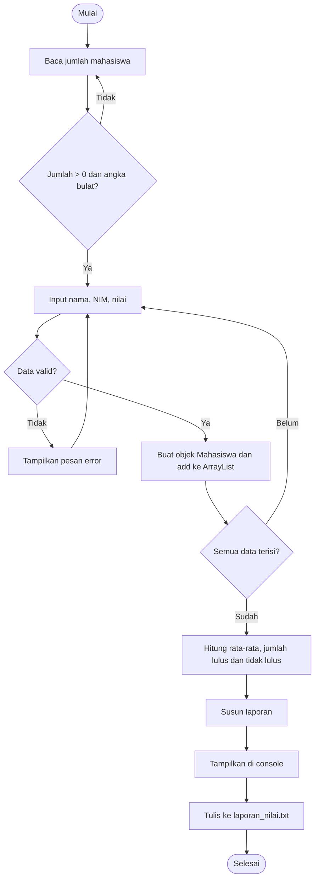
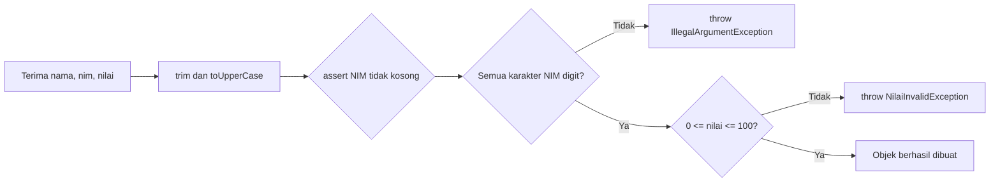

# Program Pengelolaan Nilai Mahasiswa

**Tugas Pengganti Pertemuan 7: Pemrograman Berorientasi Objek (Java)**

| | |
|---|---|
| **Nama** | Febrian Zaki Hidayatulloh |
| **NIM** | L0325045 |
| **Mata Kuliah** | Pemrograman Berorientasi Objek |
| **Bahasa** | Java (JDK 11+) |
| **IDE** | Apache NetBeans (project `Pert7PBO`) |

---

## Daftar Isi

1. [Deskripsi Program](#1-deskripsi-program)
2. [Tujuan Pembelajaran](#2-tujuan-pembelajaran)
3. [Fitur Utama](#3-fitur-utama)
4. [Struktur Project](#4-struktur-project)
5. [Arsitektur dan Diagram](#5-arsitektur-dan-diagram)
6. [Penjelasan Detail Kelas](#6-penjelasan-detail-kelas)
7. [Aturan Bisnis](#7-aturan-bisnis)
8. [Validasi dan Penanganan Error](#8-validasi-dan-penanganan-error)
9. [Pemetaan Materi Pertemuan 2-6](#9-pemetaan-materi-pertemuan-2-6)
10. [Cara Menjalankan](#10-cara-menjalankan)
11. [Contoh Penggunaan](#11-contoh-penggunaan)
12. [Skenario Pengujian](#12-skenario-pengujian)
13. [Pemecahan Masalah](#13-pemecahan-masalah)
14. [Rencana Pengembangan](#14-rencana-pengembangan)
15. [Identitas Penulis](#15-identitas-penulis)

---

## 1. Deskripsi Program

Program ini adalah aplikasi konsol (console) berbasis Java yang mengelola data nilai mahasiswa secara terstruktur dengan pendekatan pemrograman berorientasi objek. Alur kerja program:

1. Pengguna memasukkan jumlah mahasiswa, lalu data tiap mahasiswa (nama, NIM, nilai) melalui `Scanner`.
2. Setiap data divalidasi memakai **assertion**, **custom exception**, dan manipulasi **String/Character**.
3. Data yang valid disimpan sebagai objek `Mahasiswa` di dalam `ArrayList`.
4. Program memetakan nilai ke **grade huruf**, menentukan **status kelulusan**, dan menghitung **statistik kelas**.
5. Seluruh rekapitulasi ditampilkan di layar dan disimpan permanen ke file `laporan_nilai.txt` memakai **File I/O**.

---

## 2. Tujuan Pembelajaran

Program ini dibuat untuk menerapkan materi Pertemuan 2 sampai 6 dalam satu program utuh:

- Mengorganisasi kode ke dalam **package**, **class**, dan **constructor**.
- Memakai **kondisional**, **looping**, serta membedakan tipe **primitif** dan **reference**.
- Menangani kesalahan dengan **exception handling**, **custom exception**, dan **assertion**.
- Mengelola data dinamis dengan **Collection Framework** (`ArrayList`).
- Membaca input dengan **Scanner** dan menulis file dengan **BufferedWriter**/**FileWriter**.

---

## 3. Fitur Utama

- Input data banyak mahasiswa secara dinamis.
- Validasi berlapis: nilai, NIM, nama, dan format angka.
- Pengulangan input otomatis jika data tidak valid (program tidak berhenti/crash).
- Normalisasi data: nama dirapikan dan diubah ke huruf kapital.
- Pemetaan nilai ke grade **A, B, C, D**.
- Penentuan status **LULUS / TIDAK LULUS**.
- Statistik kelas: jumlah mahasiswa, rata-rata, jumlah lulus, jumlah tidak lulus.
- Laporan berformat tabel rapi, tampil di console dan tersimpan di `laporan_nilai.txt`.
- Penutupan resource yang aman (`try-with-resources` dan `finally`).

---

## 4. Struktur Project

```
Pert7PBO/
├── src/
│   ├── model/
│   │   ├── Mahasiswa.java
│   │   └── NilaiInvalidException.java
│   └── app/
│       └── Main.java
├── laporan_nilai.txt          <- dihasilkan otomatis saat program dijalankan
└── README.md
```

| File | Package | Peran |
|---|---|---|
| `Mahasiswa.java` | `model` | Kelas data (entity): atribut, constructor, validasi, grade, status |
| `NilaiInvalidException.java` | `model` | Custom exception untuk nilai di luar rentang 0-100 |
| `Main.java` | `app` | Kelas utama: input pengguna, pengolahan koleksi, statistik, penulisan file |

Pemisahan package ini mengikuti prinsip **separation of concerns**: `model` berisi data dan aturan, sedangkan `app` berisi alur eksekusi program.

---

## 5. Arsitektur dan Diagram

### 5.1 Diagram Kelas



### 5.2 Diagram Alur Program



### 5.3 Alur Validasi di Constructor `Mahasiswa`



---

## 6. Penjelasan Detail Kelas

### 6.1 `model.NilaiInvalidException`

Custom exception turunan `Exception` (checked exception). Dilempar ketika nilai kurang dari 0 atau lebih dari 100. Karena checked, kompilator memaksa pemanggil menangani atau mendeklarasikannya, sehingga validasi nilai tidak mungkin terlewat.

### 6.2 `model.Mahasiswa`

**Atribut**

| Atribut | Tipe | Jenis | Keterangan |
|---|---|---|---|
| `FINAL_PASSING_GRADE` | `double` | `public static final` | Konstanta batas kelulusan = 70.0 |
| `nama` | `String` | reference type | Nama mahasiswa (disimpan huruf kapital) |
| `nim` | `String` | reference type | NIM (hanya digit) |
| `nilai` | `double` | primitive type | Nilai akhir (0-100) |

**Constructor** `Mahasiswa(String nama, String nim, double nilai) throws NilaiInvalidException`

Urutan proses:
1. `nama.trim().toUpperCase()` merapikan nama.
2. `nim.trim()` membuang spasi di NIM.
3. `assert !nim.isEmpty() : "NIM tidak boleh kosong!"` memastikan NIM tidak kosong.
4. Perulangan `Character.isDigit()` memastikan setiap karakter NIM adalah angka, jika tidak maka `IllegalArgumentException`.
5. Pengecekan rentang nilai, jika di luar 0-100 maka `NilaiInvalidException`.

**Method**

| Method | Return | Fungsi |
|---|---|---|
| `getNama()` | `String` | Mengambil nama |
| `getNim()` | `String` | Mengambil NIM |
| `getNilai()` | `double` | Mengambil nilai |
| `getGrade()` | `String` | Memetakan nilai ke A/B/C/D dengan if-else |
| `isLulus()` | `boolean` | `true` jika nilai >= `FINAL_PASSING_GRADE` |
| `getStatus()` | `String` | "LULUS" atau "TIDAK LULUS" (operator ternary) |

### 6.3 `app.Main`

| Method | Fungsi |
|---|---|
| `main(String[] args)` | Titik masuk program: membuat `ArrayList`, membaca input dalam loop `while`, menangkap berbagai exception, lalu memanggil `tampilkanDanSimpan` |
| `bacaJumlah(Scanner)` | Meminta jumlah mahasiswa berulang-ulang sampai pengguna memasukkan bilangan bulat > 0 |
| `tampilkanDanSimpan(ArrayList<Mahasiswa>)` | Menghitung statistik dengan for-each, menyusun laporan dengan `StringBuilder`, menampilkannya, dan menulisnya ke file |

**Penanganan exception di `main`:**

| Exception | Penyebab | Reaksi |
|---|---|---|
| `NilaiInvalidException` | Nilai di luar 0-100 | Pesan error, ulangi input |
| `NumberFormatException` | Nilai bukan angka | Pesan error, ulangi input |
| `IllegalArgumentException` | Nama/NIM kosong atau NIM berisi non-digit | Pesan error, ulangi input |
| `AssertionError` | Assertion NIM kosong gagal (jika `-ea` aktif) | Pesan `[ASSERT]`, ulangi input |
| `IOException` | Gagal menulis file | Pesan error, program tetap selesai normal |

---

## 7. Aturan Bisnis

### 7.1 Pemetaan Grade

| Rentang Nilai | Grade |
|---|---|
| 85 - 100 | **A** |
| 75 - < 85 | **B** |
| 65 - < 75 | **C** |
| 0 - < 65 | **D** |

### 7.2 Status Kelulusan

Mahasiswa dinyatakan **LULUS** jika `nilai >= FINAL_PASSING_GRADE` (70.0), selain itu **TIDAK LULUS**.

> Grade dan status dihitung terpisah. Contoh: nilai 65 mendapat grade **C** tetapi berstatus **TIDAK LULUS** karena di bawah batas 70.

### 7.3 Statistik Kelas

- **Rata-rata** = total seluruh nilai / jumlah mahasiswa
- **Jumlah lulus** dan **jumlah tidak lulus** dihitung dari `isLulus()` tiap mahasiswa

---

## 8. Validasi dan Penanganan Error

| No | Input | Aturan | Pesan |
|---|---|---|---|
| 1 | Jumlah mahasiswa | Bilangan bulat > 0 | `Masukkan bilangan bulat!` / `Jumlah harus lebih dari 0.` |
| 2 | Nama | Tidak boleh kosong | `Nama tidak boleh kosong!` |
| 3 | NIM | Tidak boleh kosong | `NIM tidak boleh kosong!` |
| 4 | NIM | Hanya digit | `NIM hanya boleh berisi angka!` |
| 5 | Nilai | Harus angka | `Nilai harus berupa angka!` |
| 6 | Nilai | 0 sampai 100 | `Nilai ... tidak valid! Nilai harus antara 0 sampai 100.` |
| 7 | File | Dapat ditulis | `Gagal menulis file: ...` |

> **Catatan assertion:** `assert` hanya berjalan jika JVM dijalankan dengan opsi `-ea`. Karena itu `Main` juga mengecek NIM kosong secara manual, sehingga program tetap aman walaupun assertion tidak aktif.

---

## 9. Pemetaan Materi Pertemuan 2-6

### Pertemuan 2: Package, Class, Constructor, Variabel

| Indikator | Implementasi |
|---|---|
| Package `model` dan `app` | `model/Mahasiswa.java`, `model/NilaiInvalidException.java`, `app/Main.java` |
| Kelas `Mahasiswa` (nama, nim, nilai) | Atribut `private String nama`, `private String nim`, `private double nilai` |
| Constructor | `Mahasiswa(String, String, double)` |
| Kata kunci `final` | `public static final double FINAL_PASSING_GRADE = 70.0` |

### Pertemuan 3: Kondisional, Looping, Tipe Data

| Indikator | Implementasi |
|---|---|
| If-else untuk grade dan status | `getGrade()` dan `isLulus()` |
| Looping | `while` pada input data; for-each pada statistik dan penyusunan laporan |
| Primitif vs reference | Primitif: `double`, `boolean`, `int`. Reference: `Mahasiswa`, `String`, `ArrayList` |

### Pertemuan 4: Exception, Assertion, Character, String

| Indikator | Implementasi |
|---|---|
| Custom exception | `NilaiInvalidException` di-`throw` jika nilai < 0 atau > 100 |
| Assertion | `assert !this.nim.isEmpty() : "NIM tidak boleh kosong!";` |
| Method String | `trim()`, `toUpperCase()`, `isEmpty()`, `toCharArray()` |
| Kelas Character | `Character.isDigit()` untuk validasi NIM |

### Pertemuan 5: Array dan Collection

| Indikator | Implementasi |
|---|---|
| `ArrayList<Mahasiswa>` | `ArrayList<Mahasiswa> daftar = new ArrayList<>();` |
| `add()` | `daftar.add(m);` |
| `size()` | `daftar.size()` untuk jumlah dan pembagi rata-rata |
| For-each | `for (Mahasiswa m : daftar)` |

### Pertemuan 6: Input/Output dan File

| Indikator | Implementasi |
|---|---|
| Console I/O dengan `Scanner` | `scanner.nextLine()` untuk nama, NIM, nilai, dan jumlah |
| File I/O | `BufferedWriter` + `FileWriter` menulis `laporan_nilai.txt` |
| Try-catch-finally / try-with-resources | `try (BufferedWriter writer = ...)` dan `try ... finally { scanner.close(); }` |

---

## 10. Cara Menjalankan

### Prasyarat

- **JDK 11 atau lebih baru** (program memakai `String.repeat()` yang tersedia sejak Java 11).
- NetBeans, atau terminal dengan `javac` dan `java`.

### Opsi A: Apache NetBeans

1. Buat project **Java with Ant > Java Application** (atau gunakan project `Pert7PBO`).
2. Buat dua package: `model` dan `app`.
3. Salin `Mahasiswa.java` dan `NilaiInvalidException.java` ke package `model`, serta `Main.java` ke package `app`.
4. Aktifkan assertion: klik kanan project, **Properties**, **Run**, isi **VM Options** dengan `-ea`.
5. Klik kanan `Main.java`, lalu **Run File** (Shift+F6).
6. File `laporan_nilai.txt` muncul di folder project, sejajar dengan folder `src`.

### Opsi B: Terminal

Dari folder `src`:

```bash
# Kompilasi
javac -d out model/*.java app/*.java

# Jalankan (assertion aktif)
java -ea -cp out app.Main
```

Di Windows (Command Prompt), perintahnya sama; gunakan `model\*.java app\*.java` jika diperlukan.

---

## 11. Contoh Penggunaan

### Contoh Sesi Input

```
Masukkan jumlah mahasiswa: 5

--- Data Mahasiswa ke-1 ---
Nama  : Jeki
NIM   : 2025001
Nilai : 150
[ERROR] Nilai 150.0 tidak valid! Nilai harus antara 0 sampai 100. Silakan ulangi.

--- Data Mahasiswa ke-1 ---
Nama  : Jeki
NIM   : 2025001
Nilai : 85

--- Data Mahasiswa ke-2 ---
Nama  : Ridwan
NIM   : 2025002
Nilai : 90

--- Data Mahasiswa ke-3 ---
Nama  : Nisa
NIM   : 2025003
Nilai : 65

--- Data Mahasiswa ke-4 ---
Nama  : Faza
NIM   : 2025004
Nilai : 78

--- Data Mahasiswa ke-5 ---
Nama  : Asep
NIM   : 2025005
Nilai : 55
```

### Contoh Isi `laporan_nilai.txt`

```
=========== LAPORAN NILAI MAHASISWA ===========
No   Nama                 NIM          Nilai    Grade  Status
------------------------------------------------------------------
1    JEKI                 2025001      85,00    A      LULUS
2    RIDWAN               2025002      90,00    A      LULUS
3    NISA                 2025003      65,00    C      TIDAK LULUS
4    FAZA                 2025004      78,00    B      LULUS
5    ASEP                 2025005      55,00    D      TIDAK LULUS
------------------------------------------------------------------
Jumlah Mahasiswa : 5
Rata-rata Nilai  : 74,60
Jumlah Lulus     : 3
Jumlah Tdk Lulus : 2
Batas Kelulusan  : 70.0
```

### Verifikasi Perhitungan

- Rata-rata = (85 + 90 + 65 + 78 + 55) / 5 = 373 / 5 = **74,60**
- Lulus (>= 70): Jeki, Ridwan, Faza = **3**
- Tidak lulus (< 70): Nisa, Asep = **2**

> Tanda desimal (koma atau titik) mengikuti pengaturan bahasa sistem operasi (locale).

---

## 12. Skenario Pengujian

| No | Skenario | Input | Hasil yang Diharapkan | Status |
|---|---|---|---|---|
| 1 | Nilai di atas batas | Nilai `150` | `NilaiInvalidException`, input diulang | Lulus uji |
| 2 | Nilai negatif | Nilai `-5` | `NilaiInvalidException`, input diulang | Lulus uji |
| 3 | Nilai batas bawah | Nilai `0` | Diterima, grade D, TIDAK LULUS | Lulus uji |
| 4 | Nilai batas atas | Nilai `100` | Diterima, grade A, LULUS | Lulus uji |
| 5 | Nilai bukan angka | Nilai `abc` | "Nilai harus berupa angka!" | Lulus uji |
| 6 | NIM berisi huruf | NIM `L0325045` | "NIM hanya boleh berisi angka!" | Lulus uji |
| 7 | NIM kosong | NIM *(kosong)* | "NIM tidak boleh kosong!" | Lulus uji |
| 8 | Nama kosong | Nama *(kosong)* | "Nama tidak boleh kosong!" | Lulus uji |
| 9 | Jumlah mahasiswa tidak valid | `0` atau `abc` | Diminta mengulang | Lulus uji |
| 10 | Nilai tepat 70 | Nilai `70` | Grade C, LULUS | Lulus uji |
| 11 | Nama berspasi dan huruf kecil | `  jeki  ` | Tersimpan `JEKI` | Lulus uji |
| 12 | Data valid lengkap | 5 mahasiswa valid | Laporan tampil dan file tersimpan | Lulus uji |

> Skenario 1, 6, dan 12 telah diuji dan didokumentasikan lewat screenshot output. Pada skenario 6, NIM `L0325045` memang ditolak karena mengandung huruf "L" (sesuai aturan validasi bahwa NIM hanya berisi angka).

---

## 13. Pemecahan Masalah

| Masalah | Penyebab | Solusi |
|---|---|---|
| `cannot find symbol: repeat` | Java versi di bawah 11 | Perbarui JDK ke 11+, atau ganti `"-".repeat(66)` dengan string garis biasa |
| `package model does not exist` | Struktur folder/package tidak sesuai | Pastikan folder `model` dan `app` ada dan baris `package` di tiap file cocok |
| Assertion tidak bekerja | JVM dijalankan tanpa `-ea` | Tambahkan `-ea` di VM Options atau perintah `java` |
| `laporan_nilai.txt` tidak ditemukan | Dicari di folder yang salah | Cek folder tempat program dijalankan (di NetBeans: folder project, bukan `src`) |
| Angka tampil `74,60` bukan `74.60` | Locale Windows memakai koma | Normal; bukan kesalahan program |
| Program menunggu terus di console | Input belum diketik/Enter belum ditekan | Ketik data lalu tekan Enter |

---

## 14. Rencana Pengembangan

Ide untuk pengembangan lebih lanjut (di luar ketentuan tugas):

- Mengurutkan daftar berdasarkan nilai tertinggi (`Collections.sort` / `Comparator`).
- Menampilkan nilai tertinggi, terendah, dan modus kelas.
- Menambah mode membaca data dari file (`BufferedReader`) selain input manual.
- Menolak NIM duplikat dengan memeriksa isi `ArrayList` sebelum `add()`.
- Menambah menu interaktif (tambah, cari, hapus, simpan).
- Memisahkan logika laporan ke kelas tersendiri (`LaporanService`).
- Menambah unit test dengan JUnit untuk `getGrade()` dan validasi constructor.

---

## 15. Identitas Penulis

| | |
|---|---|
| **Nama** | Febrian Zaki Hidayatulloh |
| **NIM** | L0325045 |
| **Mata Kuliah** | Pemrograman Berorientasi Objek |
| **Tugas** | Pengganti Pertemuan 7 |
